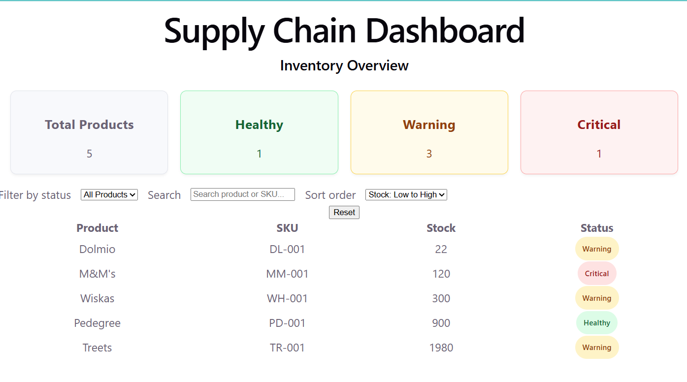
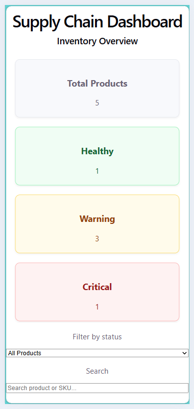

# Supply Chain Exception Dashboard

A responsive inventory dashboard built with **React, TypeScript, and Vite** to help supply-chain teams spot inventory risks, explore stock levels, and identify products that may need attention.

> **Portfolio project:** This is an independent concept inspired by a Front-End Developer / Business Analyst job opportunity at Mars. It is not a Mars product and uses fictional inventory data only.

## Project Overview

Supply-chain planners need to recognize inventory exceptions quickly without searching through complex spreadsheets or datasets. This dashboard brings key stock information into one interface, combining an inventory overview with filtering, sorting, and product-level details.

## Why I Built This

After applying for a Front-End Developer / Business Analyst role at Mars, I wanted to explore how frontend development could support real business decisions. I built this project to practice turning inventory data into an intuitive, actionable user experience.

My focus was on **usability, visual hierarchy, reusable components, business logic, and responsive design** rather than simply displaying a dataset.

## Features

- **Inventory overview:** Summary cards display total products and counts by inventory status.
- **Risk classification:** Products are automatically labeled **Critical**, **Warning**, or **Healthy** based on days of stock.
- **Status filtering:** Show all products or focus on a single inventory status.
- **Product search:** Search by product name or SKU, without case sensitivity.
- **Stock sorting:** Sort stock quantities from low to high or high to low.
- **Reset controls:** Restore the default filter, search, and sort settings.
- **Empty state:** Show a helpful message when no products match the current filters.
- **Product details:** Select a table row to inspect stock, demand, category, SKU, and days of stock; close the details when finished.
- **Selected-row highlight:** Visually indicate which product is being inspected.
- **Responsive layout:** Adapt detail cards and filters for smaller screens, with horizontal scrolling for the inventory table.

## Screenshots

Add screenshots of the completed application to a `screenshots/` folder, then uncomment the following Markdown in this section:

### Desktop



### Mobile



## Live Demo

🚀 **[View Live Dashboard](https://phenomenal-sundae-adc409.netlify.app)**

Explore the Supply Chain Exception Dashboard live, including inventory filtering, stock sorting, and product details.

## Tech Stack

| Technology | Purpose                                                         |
| ---------- | --------------------------------------------------------------- |
| React      | Component-based user interface and state management             |
| TypeScript | Typed inventory models, component props, and status values      |
| Vite       | Development server and production build                         |
| CSS        | Layout, status indicators, interactions, and responsive styling |

## Business Logic

Inventory status is derived from the estimated **days of stock**. The status calculation is kept separate from the UI in `src/utils/inventoryStatus.ts`.

| Status       | Days of stock    |
| ------------ | ---------------- |
| **Critical** | 3 days or fewer  |
| **Warning**  | 4–7 days         |
| **Healthy**  | More than 7 days |

The inventory enrichment utility applies the status calculation to each item, so UI components can work with a consistent `EnrichedInventoryItem` type.

The summary cards reflect the full inventory dataset, while the table responds to the user's current search, status filter, and sort order.

## Project Structure

```text
src/
├── components/
│   ├── FilterBar.tsx
│   ├── InventoryTable.tsx
│   ├── ProductDetails.tsx
│   ├── StatusBadge.tsx
│   ├── SummaryCard.tsx
│   └── SummaryCards.tsx
├── data/
│   └── inventory.ts
├── types/
│   └── inventory.ts
├── utils/
│   ├── enrichInventory.ts
│   └── inventoryStatus.ts
├── App.tsx
└── main.tsx
```

**Key responsibilities:**

- `App.tsx` coordinates state, filtering, sorting, selection, and component communication.
- `FilterBar.tsx` provides the status filter, product/SKU search, and stock sort controls.
- `InventoryTable.tsx` displays the matching products and handles row selection.
- `ProductDetails.tsx` presents additional information about the selected product.
- `SummaryCards.tsx` and `SummaryCard.tsx` display inventory overview metrics.
- `StatusBadge.tsx` provides a reusable visual inventory-status indicator.
- `data/` contains fictional product records; `types/` defines their TypeScript shapes; `utils/` contains reusable inventory logic.

## Getting Started

### Requirements

- Node.js and npm

### Run locally

```bash
npm install
npm run dev
```

Open the local URL printed by Vite in your terminal (commonly `http://localhost:5173/`).

### Production build

```bash
npm run build
```

The build checks TypeScript and generates production assets using the project's build configuration.

## What I Learned

- Defining domain models with TypeScript interfaces, union types, and intersection types.
- Transforming inventory data with `.map()` and summarizing it with `.reduce()`.
- Combining search and status conditions using `.filter()` and boolean logic.
- Sorting arrays without mutating the source using `[...items].sort()`.
- Managing UI state with `useState`.
- Passing data and callbacks between parent and child components.
- Rendering components conditionally, including empty states and product details.
- Reusing components and applying conditional CSS classes.
- Building responsive layouts with CSS Grid, Flexbox, and media queries.

For more detailed implementation notes and code examples, see [Learning Notes](docs/LEARNING_NOTES.md).

## Future Improvements

Potential next iterations include:

- Connect to an inventory API instead of using local fictional data.
- Visualize historical inventory trends.
- Add demand forecasting and configurable risk thresholds.
- Support inventory by warehouse or location.
- Explore replenishment recommendations.
- Add automated tests for business logic and interactive features.

## Disclaimer

This is an **independent portfolio project** inspired by a job opportunity at Mars. It is not affiliated with or endorsed by Mars and is not based on Mars internal systems or data. All inventory records are fictional.
